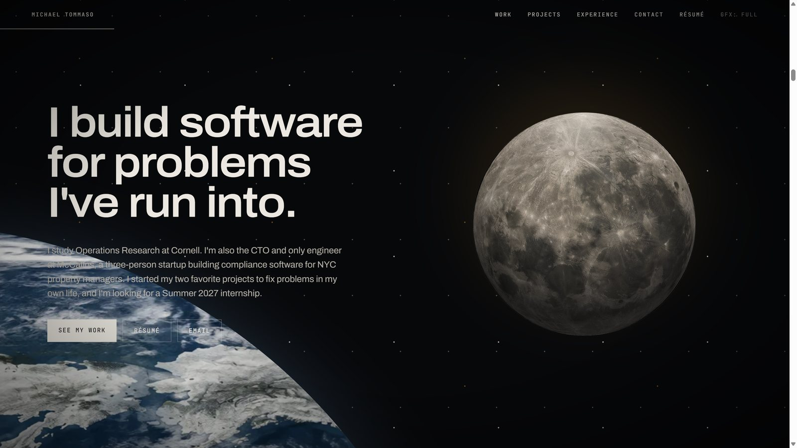
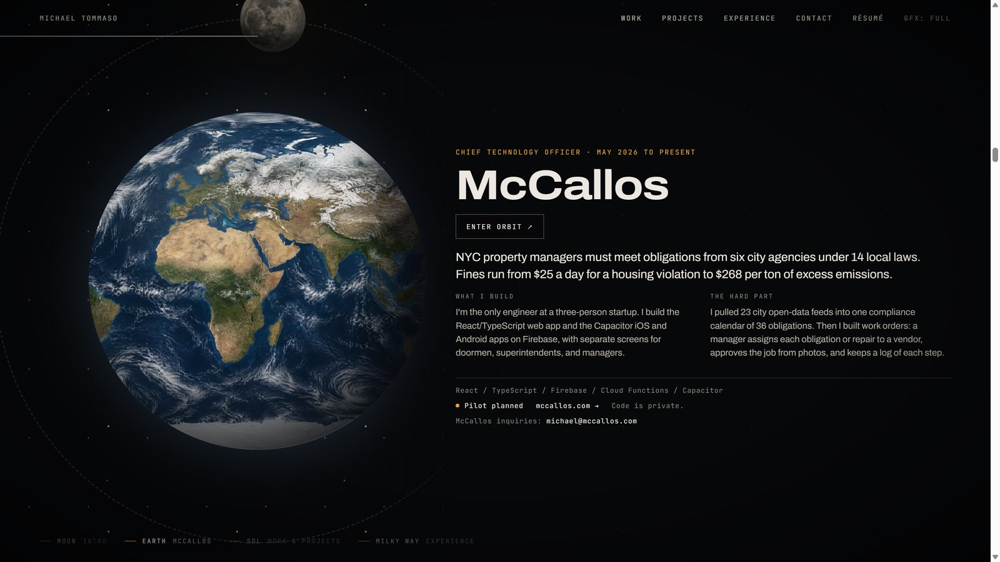
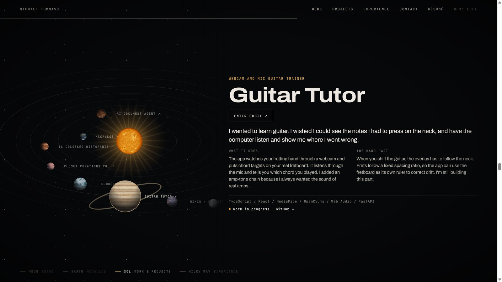
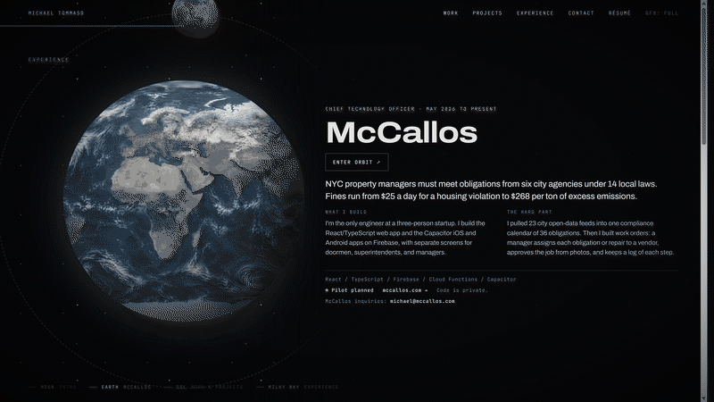
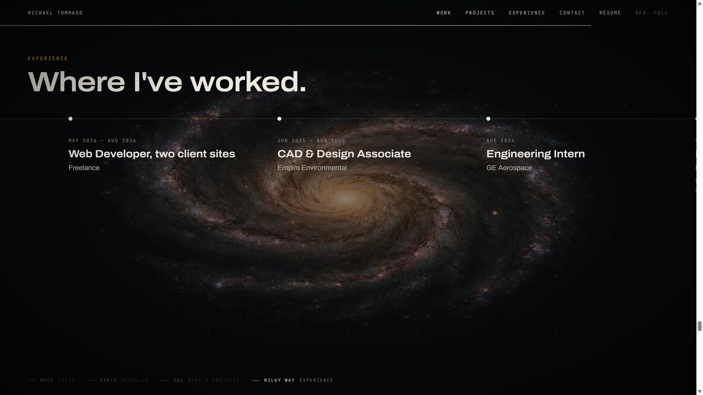
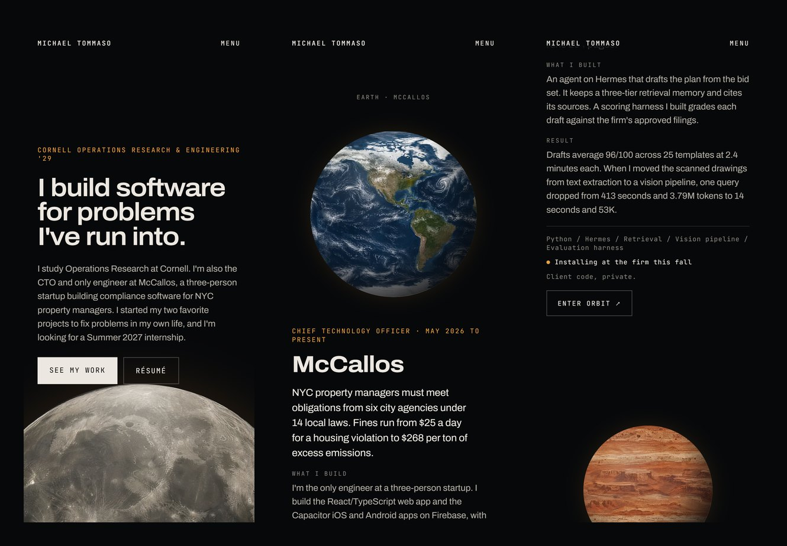
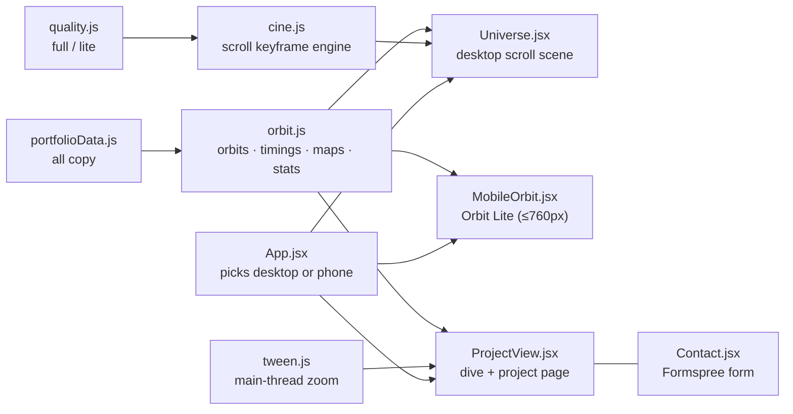

<div align="center">

# Orbit · Michael Tommaso's portfolio

**A scroll-driven trip from the Moon to the Milky Way, where every project is a planet you can fly into.**

[](https://github.com/michaeljtommaso/MichaelTommasoPortfolioWebsite/actions/workflows/static.yml)


[**Live site →**](https://michaeltommaso.com) &nbsp;·&nbsp; [How it works](#engineering-highlights) &nbsp;·&nbsp; [Previous version (Atlas)](https://github.com/michaeljtommaso/MichaelTommasoPortfolioWebsite/tree/atlas)

</div>



## Why it exists

Most portfolios are a grid of cards. I wanted mine to feel like one continuous shot: you scroll and the
camera pulls back from the Moon to Earth, out to a solar system where each project orbits as its own planet, and
finally to the Milky Way for my experience. A recruiter can still read every project in a few seconds; the
cinema is the stage, not a disguise.

## What it does

- **One camera move, scrubbed by scroll.** Moon (intro) → Earth (McCallos, my startup) → a solar system with one
  planet per project → the Milky Way (experience and education) → a moonrise behind the contact form.
- **Every project is a planet.** Each card swings into view as its planet passes the front of its orbit. Click a
  planet (or "Enter orbit") and the camera dives into it: the planet grows to fill the screen and settles into a
  horizon under the project page, with real screenshots, stats, stack and links.
- **Real art, not stock.** The Moon, Sun, galaxy and all eight planet surfaces are AI-generated stills. The Earth
  is NASA's Blue Marble map restyled, so the continents are real. Planets turn on their axis instead of spinning
  like records.
- **A phone version that isn't a squeeze.** Below 760px the site becomes *Orbit Lite*: the same universe as a
  vertical story with native scroll, turning planets and the same project pages.
- **Adapts to the machine.** If scrolling runs under about 40 fps, it switches itself to a lite graphics mode once
  per visit; a **GFX** toggle in the header lets anyone choose.

| Earth: McCallos | The solar system |
|---|---|
|  |  |
| **Diving into a planet** | **The Milky Way: experience** |
|  |  |



## Engineering highlights

- **A tiny declarative motion engine.** [`src/lib/cine.js`](src/lib/cine.js) reads keyframes straight from markup
  (`data-fx="scale 0.3167:24.23 0.3639:0.85 io; opacity …"`) and drives them from scroll progress on one rAF loop.
  It idles when nothing moves, skips identical style writes, and eases on real time, so the camera doesn't fall
  further behind your scroll when frames drop. The whole site ships with two runtime dependencies: React and
  React DOM.
- **Rendering that holds up on integrated GPUs.** The camera layers zoom from about 79x down to 0.01x, which is a
  minefield for Chrome's tile rasterizer. Two lessons are written into the code:
  - `will-change: transform` pins a layer's raster scale where it first paints. On these layers that asked for
    1.4 to 2.4 GB of tiles, and Chrome silently skipped whole rectangles. They're gone, and I verified the fix with
    Chrome's own tile-manager trace counters (0 out-of-memory passes, 0 missing tiles) on the hardware that showed
    the bug.
  - WAAPI-animated layers are drawn at the largest size they will reach, from the first frame. So the planet dive in
    [`ProjectView.jsx`](src/components/ProjectView.jsx) uses a separate cover-sized "dive ball" that's drawn once
    while it's a dot, then hands off to the full horizon at full cover, where the swap is invisible. The scene behind
    is zoomed by a main-thread tween ([`src/lib/tween.js`](src/lib/tween.js)) so it rasterizes at on-screen scale.
- **Planets that turn on their axis.** Each surface is a 2:1 equirectangular map that slides sideways inside a
  circular mask on the GPU (`translate3d`, wrapped every tile), under a fixed shading layer. The maps were
  seam-blended so the wrap point is invisible, and the project view loads the large versions only on demand.
- **Adaptive quality.** [`src/lib/quality.js`](src/lib/quality.js) starts weak devices in lite mode, then measures
  the first ~40 frames of real scrolling and downgrades once if they run slow. It never upgrades on its own, so it
  can't flap. `?quality=lite` or `?quality=full` forces a mode.
- **Content as data.** Every word of copy lives in [`src/data/portfolioData.js`](src/data/portfolioData.js).
  [`src/data/orbit.js`](src/data/orbit.js) only adds what the universe needs: orbit radii, scroll timings, planet
  maps and per-project stats. The desktop scene, the phone version and the project pages all render from the same
  objects.

## Architecture



| Layer | Tech |
|---|---|
| App | React 19, Vite 8, plain CSS (inline styles carry the design handoff's values verbatim) |
| Motion | Custom scroll/keyframe engine, WAAPI, a main-thread tween with CSS-bezier easing |
| Art | Higgsfield (GPT Image 2.5) stills; Earth restyled from NASA Blue Marble; seam-blending and resizing in Pillow |
| Forms | Formspree |
| Hosting | GitHub Pages via GitHub Actions on every push to `main` |

## Repository layout

| Path | What's there |
|---|---|
| [`src/components/`](src/components) | The desktop scene, Orbit Lite, the project view, header and contact |
| [`src/lib/`](src/lib) | Motion engine, quality switch, tween + its check |
| [`src/data/`](src/data) | Site copy and the scene config |
| [`src/assets/ai/`](src/assets/ai) · [`src/assets/shots/`](src/assets/shots) | Generated art and project screenshots |
| [`design-handoff/`](design-handoff) | The Claude Design prototype this site was rebuilt from |
| [`docs/media/`](docs/media) | Images for this README |

## Running it locally

```bash
npm ci
npm run dev        # dev server
npm run build      # production build to dist/
npm run preview    # serve the build
npm run lint
node src/lib/tween.check.mjs   # sanity check for the easing math
```

Add `?quality=lite` to the URL to see the lite graphics mode. Narrow the window below 760px for Orbit Lite.

## Versions

| Version | Where | What it was |
|---|---|---|
| **v2 · Orbit** (current) | `main` · [live](https://michaeltommaso.com) | The scroll-driven universe described above |
| v1 · Atlas | [`atlas` branch](https://github.com/michaeljtommaso/MichaelTommasoPortfolioWebsite/tree/atlas) · tag `v1-atlas` | A light "fluid systems atlas" with project chapters, built with Tailwind and Motion |

To run the Atlas version: `git checkout atlas && npm ci && npm run dev`.

## How it was built

The design started in **Claude Design** as an HTML prototype ([`design-handoff/`](design-handoff)), with exact
keyframes, timings and tokens. I rebuilt it in React, replaced its CSS planets with **Higgsfield** art, and then
spent most of the effort making it render reliably: an adaptive quality mode, a phone version, and a two-model
code audit (Claude Fable and Claude Opus, each reproducing the bug on my laptop's GPU) that found the tile-memory
starvation behind the "missing squares".

I built it with **Claude Code as my pair programmer**. I set the direction and made the design and engineering
calls; agents implemented much of the code in reviewed steps, verified in a real browser. The
`Co-Authored-By: Claude` lines in the history reflect that working style.

## Credits

- Earth surface restyled from NASA's [Blue Marble Next Generation](https://visibleearth.nasa.gov/collection/1484/blue-marble)
  imagery (NASA Earth Observatory, public domain).
- Typefaces: [Archivo](https://fonts.google.com/specimen/Archivo) and
  [JetBrains Mono](https://fonts.google.com/specimen/JetBrains+Mono) (SIL Open Font License).
- Design prototype: Claude Design. Generated art: Higgsfield.

## License

Copyright © 2026 Michael Tommaso. **All rights reserved.** This code is published for viewing and evaluation only. See
[LICENSE](LICENSE).
